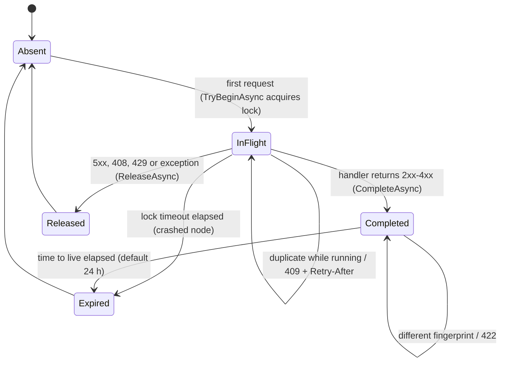
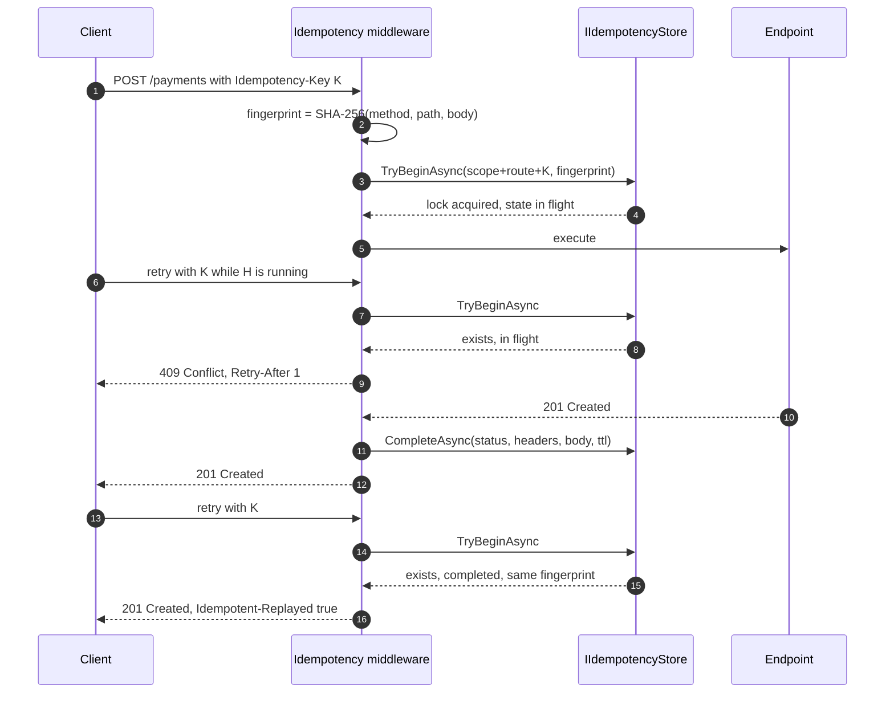

# Payments.Idempotency.AspNetCore

[](https://github.com/victorcondackdev/idempotency-aspnetcore/actions/workflows/ci.yml)
[](LICENSE)

Stripe-style idempotency keys for ASP.NET Core payment APIs.

Networks fail after the server has already charged the card. The client cannot tell a lost request
from a lost response, so it retries, and without idempotency the customer pays twice. This library
makes retries safe: a client sends the same `Idempotency-Key` for the same logical operation, the
first request executes, and every retry receives the stored response instead of a second execution.

- Minimal APIs: `app.MapPost(...).RequireIdempotency()`; controllers: `[Idempotent]`.
- Concurrent duplicates get `409 Conflict` with `Retry-After`; they never run in parallel.
- A key reused with a different payload gets `422 Unprocessable Entity`, not someone else's response.
- `5xx`, `408`, `429` and exceptions release the key, so transient failures stay retryable.
- Keys are scoped by tenant or user, HTTP method and route.
- Pluggable storage: in-memory, any `IDistributedCache`, or your own `IIdempotencyStore`.
- Expiry driven by `TimeProvider`, so TTL behavior is unit-testable with `FakeTimeProvider`.

Targets .NET 8 and depends only on the ASP.NET Core shared framework.

## Install

```sh
dotnet add package Payments.Idempotency.AspNetCore
```

## Quick start

```csharp
var builder = WebApplication.CreateBuilder(args);

builder.Services.AddProblemDetails();
builder.Services.AddIdempotency(options =>
{
    options.ScopeResolver = ctx => ctx.User.FindFirst("tenant_id")?.Value ?? "";
});

var app = builder.Build();

app.UseAuthentication();
app.UseIdempotency();          // after routing and authentication, before endpoints

app.MapPost("/payments", (CreatePayment request, PaymentService payments) =>
        Results.Created($"/payments/{payments.Charge(request).Id}", ...))
   .RequireIdempotency();                                   // header required

app.MapPost("/payments/{id}/capture", ...)
   .RequireIdempotency(timeToLive: TimeSpan.FromHours(1));  // per-endpoint replay window

app.MapPost("/quotes", ...)
   .RequireIdempotency(required: false);                    // honored when present

app.Run();
```

Controllers:

```csharp
[ApiController, Route("refunds")]
public sealed class RefundsController : ControllerBase
{
    [HttpPost, Idempotent(TimeToLiveSeconds = 3600)]
    public IActionResult Create(RefundRequest request) => ...;
}
```

Clients generate one key per logical operation (a UUID is fine) and reuse it on every retry:

```http
POST /payments HTTP/1.1
Idempotency-Key: 6f1c7c0e-2d43-4c39-9a51-0d0b3f6f8e21
Content-Type: application/json

{"amountCents": 15000, "currency": "BRL"}
```

## Semantics



The same flow from the client's point of view:



| Situation | Response |
| --- | --- |
| No header, endpoint requires it | `400` problem, `code: idempotency_key_missing` |
| Empty, repeated, non-ASCII or longer than `MaxKeyLength` (255) | `400` problem, `code: idempotency_key_invalid` |
| First request with a key | Executes; stored unless `5xx`/`408`/`429` |
| Retry, same fingerprint, completed | Stored status, headers and body plus `Idempotent-Replayed: true` |
| Retry while the first is still running | `409` problem, `Retry-After`, `code: idempotency_request_in_progress` |
| Same key, different method/path/body | `422` problem, `code: idempotency_key_mismatch` |
| Retry of a response that was too large to store | `409` problem, `code: idempotency_response_not_replayable` |
| After `TimeToLive` | The key is new again |

Details worth knowing:

- **Fingerprint.** SHA-256 over method, path and body, each length-prefixed. Add the query string
  (`IncludeQueryStringInFingerprint`) or headers (`FingerprintHeaders`) when they change the
  operation. The body is buffered with `EnableBuffering`, so endpoints still read it normally.
- **Scope.** The store key is `SHA-256(scope, method, route pattern, key)`, prefixed with
  `StoreKeyPrefix`. The default scope is the `NameIdentifier` claim, then `Identity.Name`, then a
  shared anonymous scope. Multi-tenant APIs should set `ScopeResolver` to the tenant.
- **What is replayed.** Status code, `Content-Type`, the headers in `ReplayedResponseHeaders`
  (`Location`, `ETag`, `Cache-Control`, `Content-Language` by default) and the body.
- **Response capture.** The response body is wrapped in a write-through stream: bytes reach the
  client immediately and a copy is kept up to `MaxResponseBodySize` (1 MiB). Streaming endpoints
  keep streaming. Past the limit the copy is dropped and the key is completed as *not replayable*:
  a retry gets `409` rather than a second execution, which is the safe failure mode for payments.
- **Failures.** Unhandled exceptions, `5xx` (unless `CacheServerErrors = true`) and the statuses in
  `ReleasedStatusCodes` release the lock, so a retry with the same key executes again. Store writes
  after the handler ran use `CancellationToken.None`: a client disconnect never discards a
  completed side effect.
- **Lock timeout.** An in-flight lock lives for `LockTimeout` (1 minute). If the node crashes, the
  key becomes usable again afterwards. Set it above your slowest handler; a lock that expires while
  the handler is still running could let a retry execute concurrently. The middleware logs a
  warning when it detects this.

## Options

| Option | Default | |
| --- | --- | --- |
| `HeaderName` | `Idempotency-Key` | Request header. |
| `MaxKeyLength` | `255` | Longer keys get `400`. |
| `TimeToLive` | 24 hours | Replay window; per endpoint via `RequireIdempotency(timeToLive:)` or `[Idempotent(TimeToLiveSeconds = ...)]`. |
| `LockTimeout` | 1 minute | In-flight lease. |
| `RetryAfter` | 1 second | `Retry-After` on `409`. |
| `MaxResponseBodySize` | 1 MiB | Larger responses are not replayable. |
| `CacheServerErrors` | `false` | Store and replay `5xx`. |
| `ReleasedStatusCodes` | `408`, `429` | Statuses that release the key. |
| `IncludeQueryStringInFingerprint` | `false` | |
| `FingerprintHeaders` | empty | |
| `ReplayedResponseHeaders` | `Location`, `ETag`, `Cache-Control`, `Content-Language` | `Content-Type` is always kept. |
| `ScopeResolver` | user id or name | `Func<HttpContext, string>`. |
| `StoreKeyPrefix` | `idempotency` | |

## Storage

```csharp
public interface IIdempotencyStore
{
    Task<IdempotencyBeginResult> TryBeginAsync(string key, string fingerprint, TimeSpan lockTimeout, CancellationToken ct = default);
    Task<bool> CompleteAsync(string key, string lockToken, StoredResponse? response, TimeSpan timeToLive, CancellationToken ct = default);
    Task<IdempotencyEntry?> GetAsync(string key, CancellationToken ct = default);
    Task<bool> ReleaseAsync(string key, string lockToken, CancellationToken ct = default);
}
```

`TryBeginAsync` must be atomic. `CompleteAsync` and `ReleaseAsync` take the lock token, so a
request whose lock expired and was taken over cannot overwrite the new owner's entry.

**In-memory** (default). `InMemoryIdempotencyStore` uses compare-and-swap on a
`ConcurrentDictionary`, so it is genuinely atomic, but process-local. Fine for one instance,
development and tests.

**`IDistributedCache`.** Works with whatever cache you already run:

```csharp
builder.Services.AddStackExchangeRedisCache(o => o.Configuration = "localhost:6379");
builder.Services.AddIdempotency();
builder.Services.AddDistributedCacheIdempotencyStore();
```

`IDistributedCache` has no compare-and-set, so `DistributedCacheIdempotencyStore.TryBeginAsync` is
read, write, read-back. Two requests racing within milliseconds on different nodes can both win.
That is usually acceptable as a second line of defense behind a unique constraint on the payment,
but if the key is your only protection, use a store with a native atomic primitive.

**Redis with `SET NX` (sketch).** Not shipped, to keep the package free of a StackExchange.Redis
dependency. A production version would also use a Lua script for compare-and-delete:

```csharp
public sealed class RedisIdempotencyStore(IConnectionMultiplexer redis, TimeProvider time) : IIdempotencyStore
{
    private readonly IDatabase _db = redis.GetDatabase();

    public async Task<IdempotencyBeginResult> TryBeginAsync(string key, string fingerprint, TimeSpan lockTimeout, CancellationToken ct = default)
    {
        var now = time.GetUtcNow();
        var entry = new IdempotencyEntry
        {
            Fingerprint = fingerprint, State = IdempotencyEntryState.InFlight,
            LockToken = Guid.NewGuid().ToString("N"), CreatedAt = now, ExpiresAt = now + lockTimeout,
        };

        // Atomic: only one caller can create the key.
        if (await _db.StringSetAsync(key, Serialize(entry), lockTimeout, When.NotExists))
        {
            return IdempotencyBeginResult.Locked(entry.LockToken);
        }

        var existing = Deserialize(await _db.StringGetAsync(key));
        return existing is null
            ? await TryBeginAsync(key, fingerprint, lockTimeout, ct)   // expired between calls
            : IdempotencyBeginResult.Exists(existing);
    }

    // CompleteAsync: Lua script that checks the stored lockToken, then SET key value PX ttl.
    // ReleaseAsync:  Lua script that checks the stored lockToken, then DEL key.
    // GetAsync:      GET key and deserialize.
}
```

## Testing

Register a `FakeTimeProvider` before `AddIdempotency` (which only adds `TimeProvider.System` when
none is registered) and move time explicitly:

```csharp
var time = new FakeTimeProvider();
builder.Services.AddSingleton<TimeProvider>(time);
builder.Services.AddIdempotency();
// ...
time.Advance(TimeSpan.FromHours(24));   // the key is now expired
```

The test suite covers replay, fingerprint mismatch, concurrent duplicates (`Task.WhenAll` against
a handler blocked on a `TaskCompletionSource`), TTL expiry, released `5xx` and exceptions, required
and optional keys, scoping, oversized responses, both stores, and an end-to-end run of
[`samples/Sample.Api`](samples/Sample.Api/Program.cs) through `WebApplicationFactory<Program>`.

```sh
dotnet test -c Release --collect:"XPlat Code Coverage"
```

## Sample

```sh
dotnet run --project samples/Sample.Api

curl -i -X POST http://localhost:5090/payments \
  -H 'Content-Type: application/json' -H 'X-Tenant-Id: acme' \
  -H 'Idempotency-Key: 3f9d1b2e-7c1a-4f4e-9d55-1f3a2b4c5d6e' \
  -d '{"amountCents":15000,"currency":"BRL","description":"Pedido 42"}'
# run it again: same payment id, plus "Idempotent-Replayed: true"
```

## License

[MIT](LICENSE) © 2026 Victor Condack
